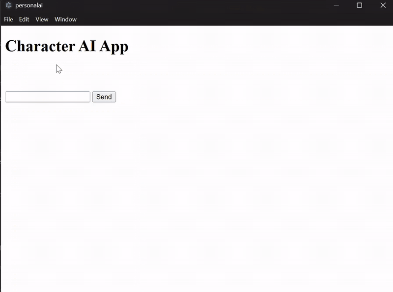

# PersonalAi: Character AI Desktop Companion

A desktop AI companion built with **Electron** and **JavaScript**. The chatbot takes on a character's personality, remembers the conversation, and (eventually) speaks its replies and reacts with animations.

>**Status:** V1 (Core Chat Application) in progress.



---

## Features (V1)

- Desktop app built with Electron (`BrowserWindow`, main + renderer processes)
- Type a message and send it with the **Send** button
- Messages are displayed dynamically in the chat window (DOM manipulation in `renderer.js`)
- **Conversation memory**: every message is stored in order in a `chatMemory` array (`renderer.js` → `storeMemory()` in `memory.js`)

## Tech Stack

| Area | Tools |
|---|---|
| Desktop shell | Electron |
| Front end | HTML, CSS, JavaScript |
| AI (planned, V2) | Claude API via a Flask backend |
| Version control | Git + GitHub (feature branches + pull requests) |

## Project Structure

```
PersonalAi/
├── main.js        # Electron main process: app startup + window creation
├── renderer.js    # UI logic: user input, event listeners, displaying messages
├── memory.js      # Conversation memory: stores messages in the chatMemory array
├── index.html     # App layout
├── style.css      # Styling
└── package.json   # Dependencies and scripts
```

## Getting Started

**Requirements:** [Node.js](https://nodejs.org/) (LTS)

```bash
git clone https://github.com/Marsad07/PersonalAi.git
cd PersonalAi
npm install
npm start
```

## Roadmap

### V1: Core Chat Application  ✅
- [x] Electron startup flow and `BrowserWindow` creation
- [x] `renderer.js` integration
- [x] User input handling and event listeners
- [x] Message display in the app window
- [x] Conversation memory system

### V2: AI Integration
- [ ] Flask backend that calls the Claude API (keeps the API key off the client)
- [ ] Upgrade memory to `{ role, content }` objects (the format the Claude API expects)
- [ ] Send user messages and display Claude's responses
- [ ] Loading / "thinking" state while waiting for a reply

### V3: Character System
- [ ] Character image above the chat area
- [ ] Multiple original characters with different personalities
- [ ] Characters defined in config files (personality prompt, name, image)
- [ ] Character remembers conversation context

### V4: Voice Features
- [ ] Text-to-speech for character replies
- [ ] Voice input
- [ ] Hands-free conversations

### V5: Character Animations
- [ ] Idle and talking animations
- [ ] Expressions/reactions based on responses

## Development Workflow

Each feature or fix is built on its own branch (e.g. `fix/conversation-memory`) and merged into `main` through a pull request. Commit messages follow [Conventional Commits](https://www.conventionalcommits.org/) (`feat:`, `fix:`, `docs:`).

## Author

**Marsad Choudhury**, BSc Software Engineering, Manchester Metropolitan University
GitHub: [@Marsad07](https://github.com/Marsad07)